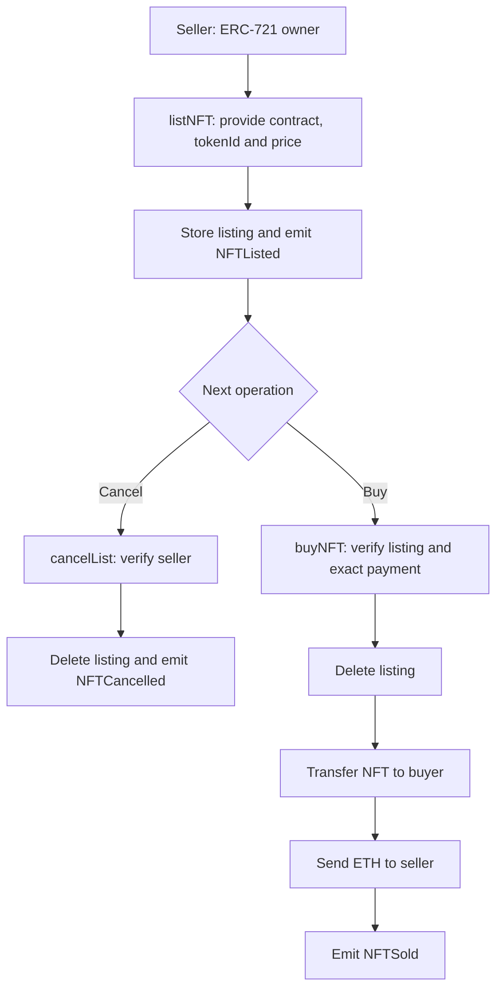
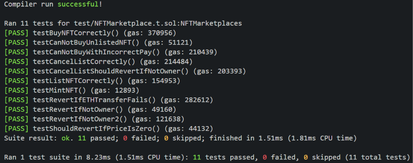
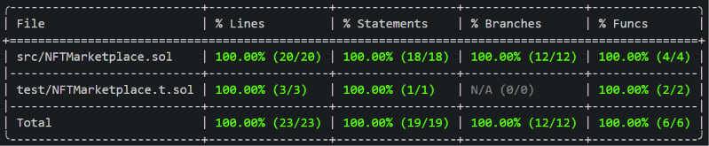

# NFT Marketplace

An educational ERC-721 NFT marketplace built with **Solidity 0.8.24** and tested using **Foundry**. It allows users to list NFTs at a fixed price in ETH, purchase listed NFTs, and cancel listings.

The main objective of this project is to practice ERC-721 contract interactions, ETH payments, access control for marketplace operations, and testing both successful and failure scenarios.

> **Scope:** Smart contract implementation and local testing. No public network deployments have been provided. Marketplace fees are a planned improvement, **not an implemented feature**.

## How it works

The system consists of the following main components:

- [`NFTMarketplace.sol`](./src/NFTMarketplace.sol): Manages NFT listings and executes listing, purchase, and cancellation operations.
- **External ERC-721 contract**: Represents the NFTs traded through the marketplace. Tests use a `MockNFT` based on OpenZeppelin, defined in [`test/`](./test/).
- [`test/`](./test/): Contains Foundry tests covering marketplace operations and expected revert scenarios.

The marketplace **does not take custody of NFTs while they are listed**. Sellers retain ownership until a purchase is completed. Before a purchase, the seller must authorize the marketplace to transfer the NFT using `approve` or `setApprovalForAll`.

### System flow



If an operation reverts, all state changes performed within that transaction are rolled back.

## Technical docs

### Main operations

| Function                                                          | Description                                       | Relevant validations                                                                                               |
| ----------------------------------------------------------------- | ------------------------------------------------- | ------------------------------------------------------------------------------------------------------------------ |
| `listNFT(address nftContract_, uint256 tokenId_, uint256 price_)` | Creates or updates a listing for an NFT.          | Price must be greater than zero, and `msg.sender` must own the NFT.                                                |
| `buyNFT(address nftContract_, uint256 tokenId_)`                  | Purchases a listed NFT by sending ETH.            | The listing must exist, `msg.value` must match the listing price, and the ETH transfer to the seller must succeed. |
| `cancelList(address nftContract_, uint256 tokenId_)`              | Removes an existing listing.                      | Only the registered seller can cancel the listing.                                                                 |
| `listing(address nftContract, uint256 tokenId)`                   | Retrieves publicly available listing information. | Returns `seller`, `nftContract`, `tokenId`, and `price`.                                                           |

**Purchase flow:** The marketplace removes the listing, requests the ERC-721 contract to transfer the NFT to the buyer, and sends ETH to the seller. If any of these operations fail, the entire transaction reverts.

**Events:** `NFTListed`, `NFTCancelled`, and `NFTSold` allow marketplace activity to be monitored.

Source code: [`src/NFTMarketplace.sol`](./src/NFTMarketplace.sol).

### Technologies

- **Solidity 0.8.24**.
- **Foundry / Forge** for compilation, testing, and coverage analysis.
- **OpenZeppelin Contracts**: `IERC721`, `ERC721`, `Ownable`, and `ReentrancyGuard`.
- **forge-std** for testing utilities, including Foundry cheatcodes.

## Execution example

The following workflow can be reproduced in the local testing environment:

1. An ERC-721 NFT is minted and assigned to the seller.
2. The seller lists the NFT by calling `listNFT(nftContract, tokenId, 1 ether)`.
3. The seller authorizes the marketplace to transfer the NFT.
4. The buyer calls `buyNFT{value: 1 ether}(nftContract, tokenId)`.
5. If the purchase succeeds, NFT ownership is transferred to the buyer, the seller receives 1 ETH, and the listing is removed.

To execute the successful purchase test:

```bash
forge test --match-test testBuyNFTCorrectly -vv
```

## Testing

Tests are located in [`test/`](./test/) and cover successful operations and expected revert scenarios, including:

- Listing an NFT with a zero price or without owning the token.
- Successfully listing and cancelling an NFT.
- Preventing unauthorized users from cancelling listings.
- Attempting to purchase an unlisted NFT or paying an incorrect amount.
- Successfully purchasing an NFT and verifying ownership, listing state, and seller balance.
- Reverting a purchase when the ETH transfer to the seller fails.

Run the tests:

```bash
forge test
```



### Test coverage

```bash
forge coverage
```

**Reported branch coverage: 12/12 (100%).** Additional coverage metrics can be reviewed in the report generated by Forge.



> Screenshots are stored in [`assets/images/`](./assets/images/) and document the results obtained in the local testing environment.

## Project structure

```text
NFT-marketplace/
├── assets/
│   └── images/
│       ├── forge_test_result.png
│       └── forge_coverage_result.png
├── lib/                 # Foundry dependencies
├── script/              # Scripts directory
├── src/
│   └── NFTMarketplace.sol
├── test/                # Foundry tests and MockNFT
├── foundry.toml         # Foundry configuration
└── README.md
```

## Requirements

- Git and [Foundry](https://getfoundry.sh/).
- Project dependencies in `lib/`, including [OpenZeppelin Contracts](https://docs.openzeppelin.com/contracts/) and [forge-std](https://github.com/foundry-rs/forge-std).
- A compiler compatible with `pragma solidity 0.8.24` (managed by Foundry according to the project configuration).

## Installation

> **TODO:** Replace `<REPOSITORY_URL>` with the public GitHub repository URL.

```bash
git clone --recurse-submodules <REPOSITORY_URL>
cd NFT-marketplace
```

If the repository has already been cloned without submodules:

```bash
git submodule update --init --recursive
```

## Build

```bash
forge build
```

To check Solidity code formatting:

```bash
forge fmt --check
```

## Deployment

No public deployment or contract addresses have been documented.

> **TODO:** Add the network, deployed contract address, and block explorer link if the project is deployed.

## Security considerations

- Listing, purchasing, and cancellation operations use OpenZeppelin's `nonReentrant` modifier.
- The marketplace verifies that a listing exists and that `msg.value` exactly matches the listing price before completing a purchase.
- The seller must retain ownership of the NFT and provide valid transfer approval for a purchase to succeed. A listing may become outdated if these conditions change.
- ETH transfers to sellers may fail. In such cases, the entire purchase transaction reverts.
- The contract inherits from `Ownable`, but the current implementation does not include administrative fee-management functions.
- This is an educational project and is not presented as an audited or production-ready smart contract.

### Potential improvements

Implementing listing or sale fees, along with an administrative function to configure the fee percentage, is a **planned extension** and is not part of the current implementation.

## License

The source contract declares `SPDX-License-Identifier: MIT`. Refer to the repository's [`LICENSE`](./LICENSE) file for the applicable license terms.
